# Mahtab

> **Mahtab** (مہتاب, "moonlight") is a clock widget **highly inspired by the
> [Kronos](https://github.com/MASH2RAFI) Omarchy plugin — full credit to
> [MASH2RAFI](https://github.com/MASH2RAFI).**
>
> **This is a vibe-coded project.** I am not a programmer; it was built
> conversationally with an AI assistant. Use it as-is and expect rough edges.

A minimal _"Good morning / afternoon / evening / night"_ clock with a stylized
faux-kana weekday, rendered on the Omarchy **wallpaper layer** — behind your
windows, so it only shows on an empty desktop.

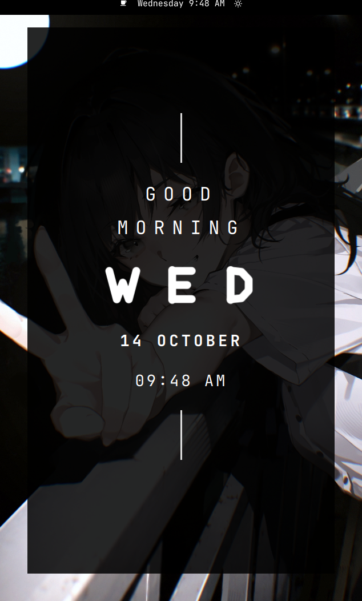

## Features

- Two layout styles: **Mahtab** (greeting card) and **Grand** (one large editorial time)
- Greeting that changes with the time of day (_Morning_, _Afternoon_, _Evening_, _Night_) in the Mahtab layout
- Stylized faux-kana weekday glyphs drawn as strokes in the Mahtab layout
- Date and time, with an optional 24-hour clock
- Optional rounded card behind the clock for readability on busy wallpapers
- Nine anchor positions **or** free-form placement by dragging the clock anywhere
- Resize by scrolling over the clock — no settings panel needed
- Multi-monitor targeting: all, primary, focused, or external only
- Live settings through a right-click panel — no shell reload required

## Layout styles

- **Mahtab** — the greeting card with a faux-kana weekday (default).
- **Grand** — a single, oversized editorial time with the colon and seconds in the
  accent colour. Ported from the Ryoku shell's `ClockGrand` face.

Pick a style under **Layout → Layout style** in the settings panel.

## Screenshots

|  |  |
|---|---|
| 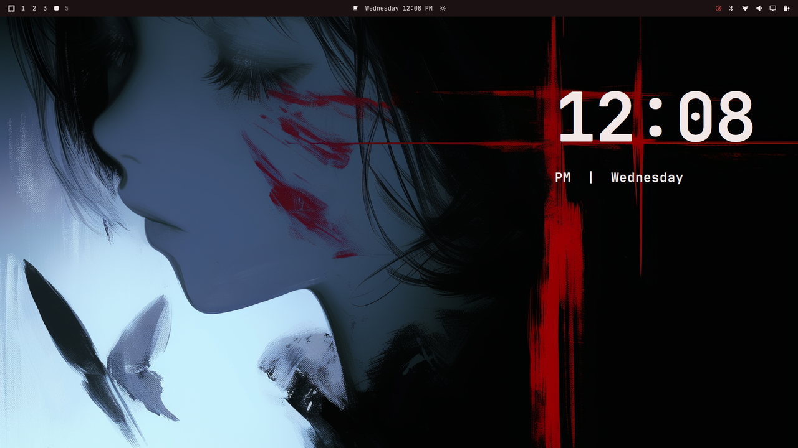 | 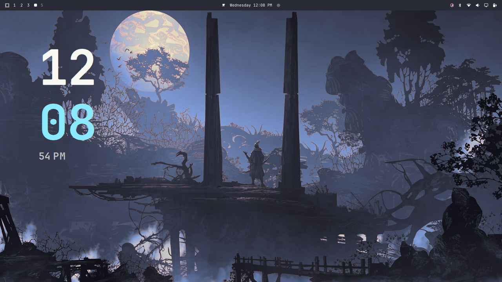 |
| 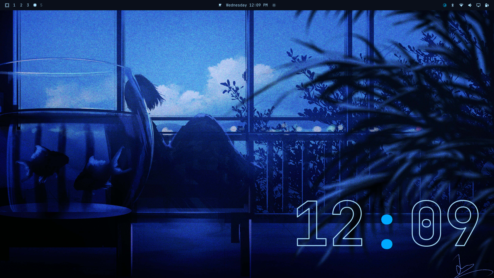 | 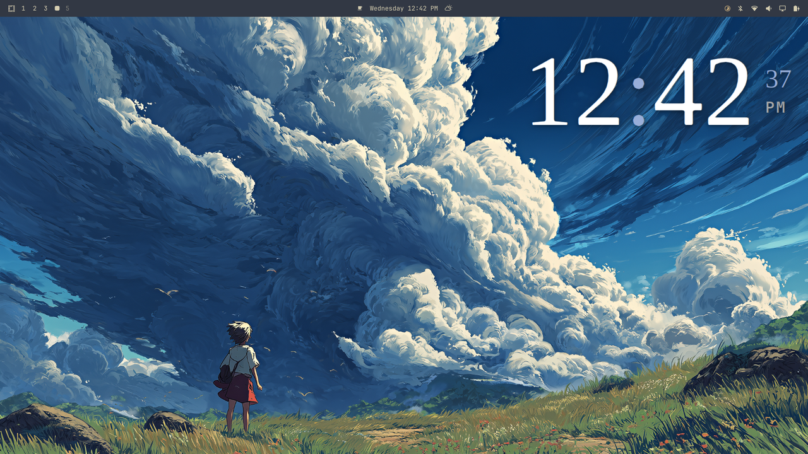 |
| 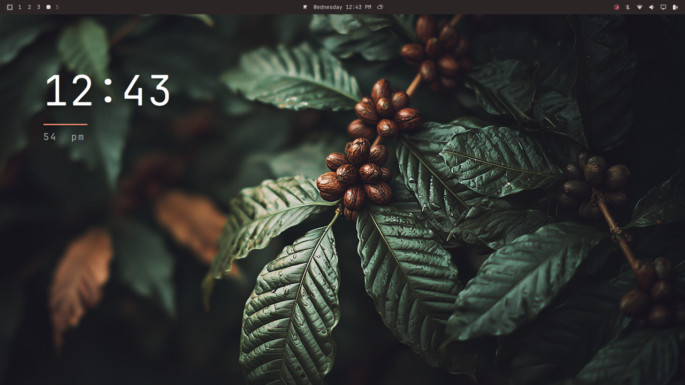 | 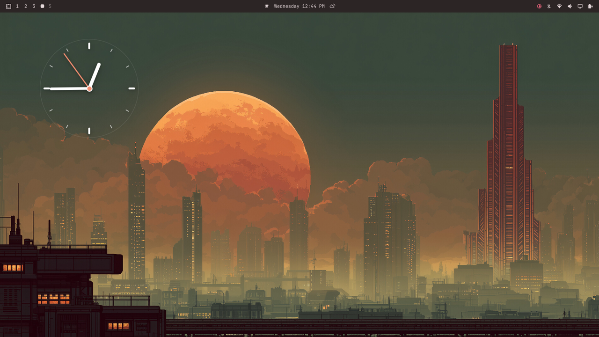 |
| 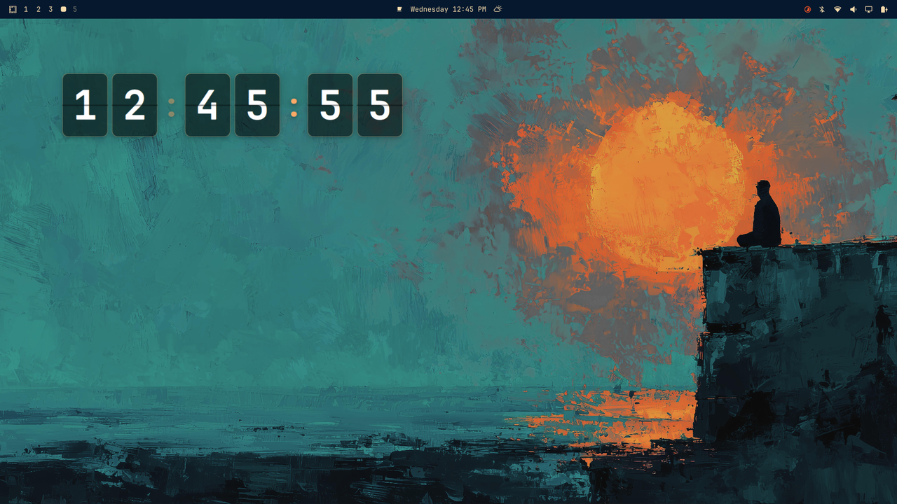 | 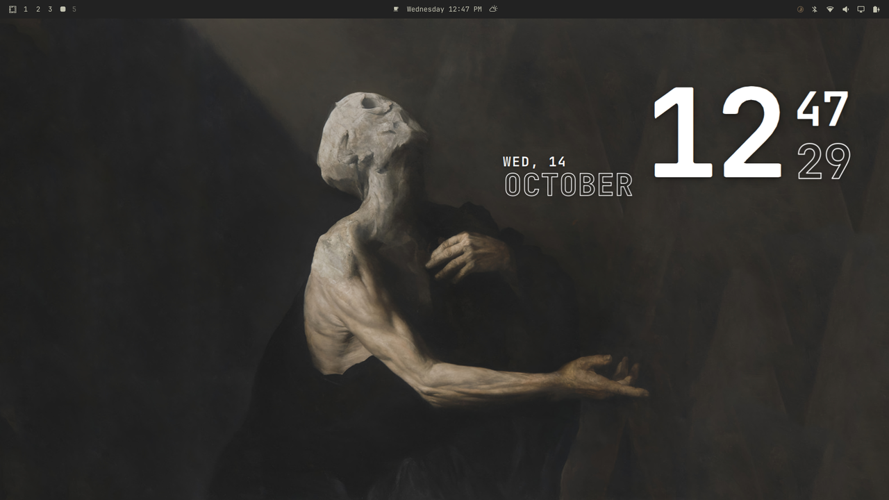 |
| 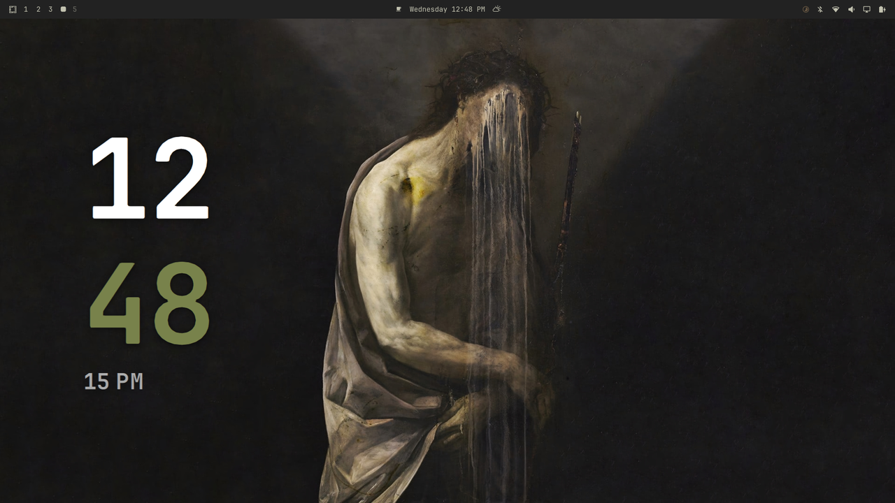 | 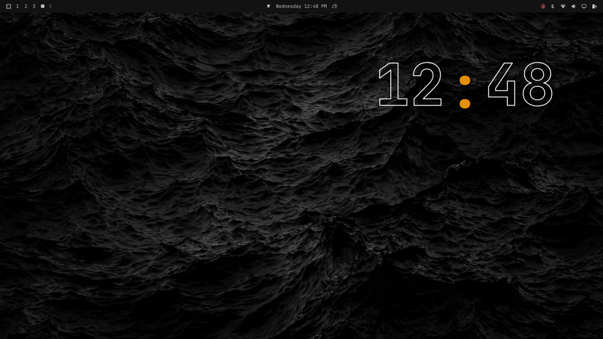 |
| 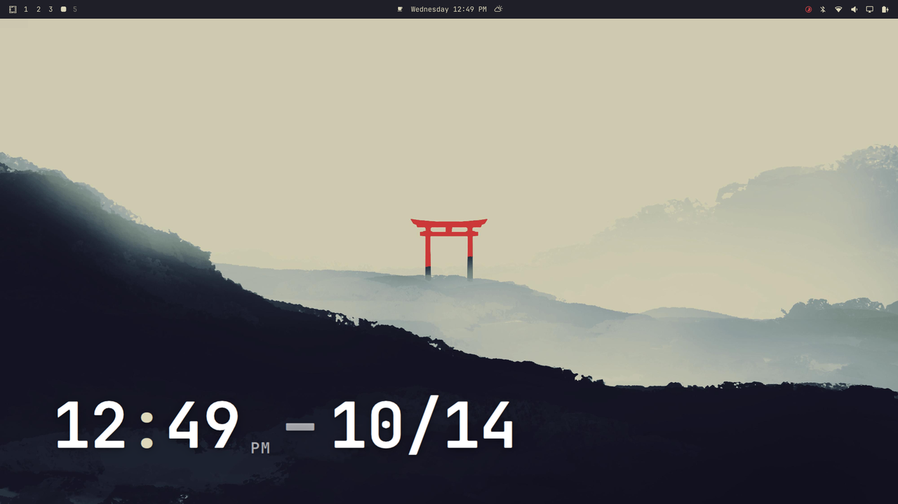 | |

## Credits

- Inspired by **Kronos** by [MASH2RAFI](https://github.com/MASH2RAFI).
- The **Grand** layout is ported from the Ryoku shell's desktop clock.
- Built for [Omarchy](https://omarchy.org) (Quattro) and its Quickshell-based shell.

## Requirements

- Omarchy (Quattro) with the Omarchy shell
- No external dependencies

## Install

```sh
omarchy plugin add https://github.com/saqib33www-collab/mahtab.git --enable
```

Then place the toggle in a bar section (the widget defaults to the right section):

```sh
omarchy bar move saqib33w.mahtab --section right
```

## Usage

- **Left-click** the bar icon to show or hide the wallpaper clock.
- **Right-click** the bar icon, or right-click the clock itself on the wallpaper,
  to open the settings panel.
- **Drag the clock directly on the wallpaper** to move it. It lifts above your
  windows while you drag, then settles back onto the wallpaper, so it slides
  smoothly even over open windows.
- **Scroll over the clock** to resize it — it eases smoothly to the new size and
  saves automatically.

## Configure

Everything is editable from the right-click settings panel and is stored in
`~/.config/omarchy/shell.json`. You can also set values from the command line:

```sh
omarchy bar set saqib33w.mahtab scale 1.4
omarchy bar set saqib33w.mahtab layout grand
omarchy bar set saqib33w.mahtab use24h true
omarchy bar set saqib33w.mahtab position middle-right
omarchy bar set saqib33w.mahtab screenMode primary
```

## Remove

```sh
omarchy plugin remove saqib33w.mahtab
```

## License

MIT — see [LICENSE](LICENSE).

### Layouts

Available faces (ported from Ryoku desktop clock): `mahtab`, `grand`, `digital`, `minimal`, `analog`, `flip`, `rings`, `bighour`, `metal`, `column`, `outline`, `banner`.

Set via:

```bash
omarchy bar set saqib33w.mahtab layout digital use24h true showSeconds false dateShow true dateLayout badge
```
